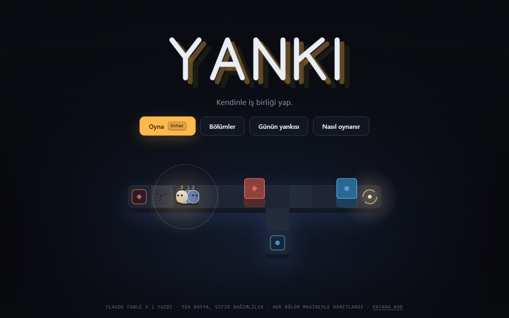
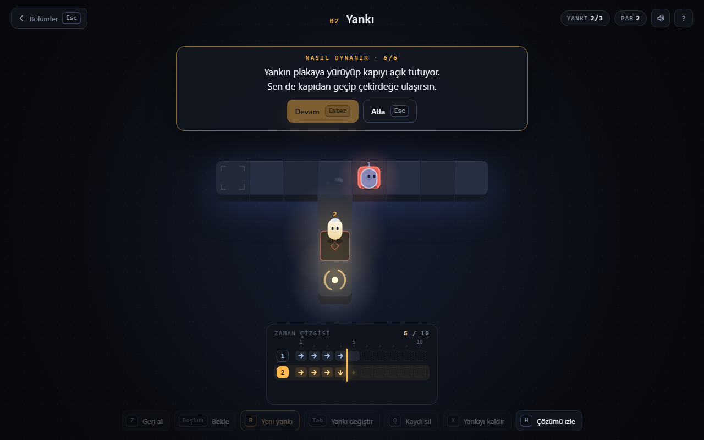
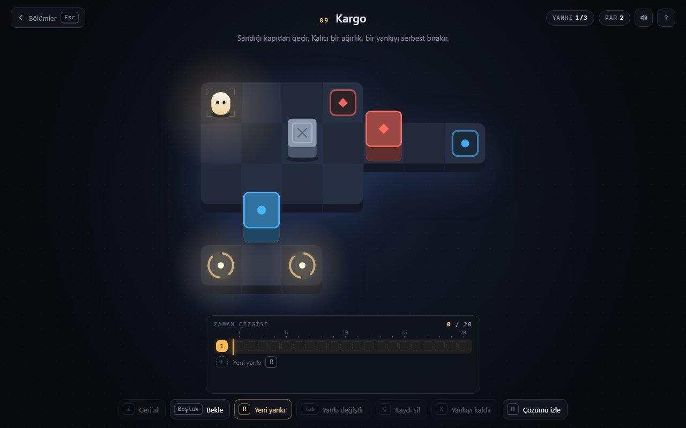
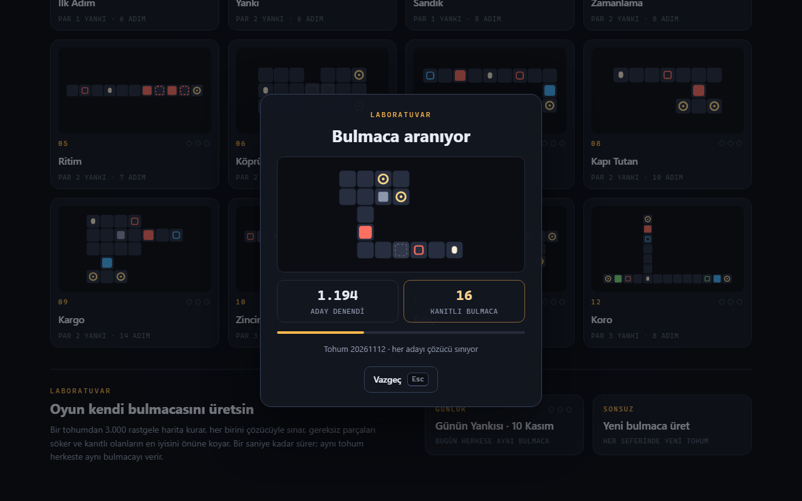

# Yankı

Kendi geçmişinle iş birliği yaptığın bir zaman döngüsü bulmacası. Tek HTML dosyası, bağımlılık yok.

**Oyna:** https://yanki-eight.vercel.app



## Nasıl oynanır

Her yankı bir tuş kaydıdır. Yürürsün, adımların zaman çizgisine yazılır. Yeni bir yankı açtığında zaman başa sarar ve önceki kayıtların aynı tuşlara aynı sırayla yeniden basar. Yankılar yolu değil tuşları tekrarlar: kapalı bir kapıya yürüyen yankı, sen o kapıyı açarsan bu sefer geçer.

Bütün çekirdekler aynı anda bir yankıyla dolunca bölüm biter.

İlk açılışta oyun bunu anlatmakla yetinmez: ikinci bölümü kendi ekranında oynayarak altı adımda gösterir. Başlık ekranındaki "Nasıl oynanır" ile yeniden izlenir.



| Tuş | İş |
| --- | --- |
| `W A S D` / ok tuşları | yürü |
| `Boşluk` | bekle (zaman akar) |
| `Z` | son adımı geri al |
| `R` | yeni yankı aç, zamanı başa sar |
| `Tab` | başka bir yankının kaydını sürdür |
| `Q` / `X` | bu yankının kaydını sil / yankıyı kaldır |
| `U` | son silineni geri getir |
| `H` | makinenin çözümünü izle |

Telefonda kaydırarak yürünür; geri kalan her şey ekrandaki düğmelerde.



## Makine kanıtı

Yankılar yalnızca tuşları tekrarladığı için, K yankılı bir bölüm K ajanın aynı anda yürüdüğü tek bir durum uzayına denktir. `src/solver.js` bu uzayı katman katman tarar:

- **Par**, çözümü olan en küçük K'dır. Bir altındaki K için uzayın tamamı tükenir ve çözüm çıkmaz.
- Par ile en kısa çözüm de bulunur; oyundaki üçüncü elmas bu adım sayısını tutturana verilir.
- Oyun ve çözücü aynı adım fonksiyonunu (`src/core.js`) çalıştırır; kurallar iki yerde yazılmadı.

Bölümler ekranındaki "Makine kanıtı" tablosu, her bölüm için taranan durum sayılarını gösterir.

## Laboratuvar

Oyun kendi bulmacasını üretir. `src/gen.js` bir tohumdan 3.000 rastgele harita kurar, her birini çözücüyle sınar, gereksiz parçaları söker (bir parça çıkınca par ve en kısa çözüm değişmiyorsa o parça süstür), kullanılmayan zemini budar ve kanıtlı olanların en iyisini açar. Yaklaşık bir saniye sürer. Aynı tohum her yerde aynı bulmacayı verir; "Günün Yankısı" tohumunu tarihten alır.



## Geliştirme

Bağımlılık yok; Node 22 ya da üstü yeter.

```bash
npm run build      # bölümleri çöz, src/* dosyalarını index.html'e göm
npm test           # uçtan uca test: penceresiz Chrome'da gerçek klavye olaylarıyla
npm run test:live  # aynı testi yayındaki siteye karşı çalıştır
npm run gen        # üreteci birkaç tohumla dene
```

- `src/core.js` kurallar · `src/solver.js` çözücü · `src/gen.js` üreteç · `src/game.js` arayüz, çizim, ses · `src/levels.js` bölümler
- `tools/e2e.js` 70 kontrol yapar: ilk açılış anlatımını baştan sona izler, 12 bölümü çözücünün çözümüyle oynar, rastgele eylem dizileriyle arayüz durumunu çekirdek simülasyonuyla karşılaştırır, Laboratuvar'ın tarayıcıda ve Node'da aynı bulmacayı ürettiğini sınar.
- `tools/cdp.js` küçük bir Chrome DevTools Protocol sürücüsüdür (Node'un yerleşik WebSocket'i); Playwright ya da Puppeteer gerekmez. Chrome başka bir yoldaysa `CHROME_PATH` ile belirt.

## Nasıl yapıldı

Oyunun tamamını (tasarım, kurallar, çözücü, üreteç, çizim, ses sentezi, testler) Claude Fable 5.2 tek oturumda yazdı. İstek şuydu: "ne yapabildiğini göster, ne yapacağın sana kalmış."

## Lisans

MIT

---

**English:** Yankı ("echo") is a time-loop puzzle where you cooperate with recordings of your own past moves. Every level's par (the minimum number of echoes) is proven by an exhaustive solver, and a built-in generator produces new machine-verified puzzles from a seed. Single HTML file, no dependencies. Written by Claude Fable 5.2 in one session.
